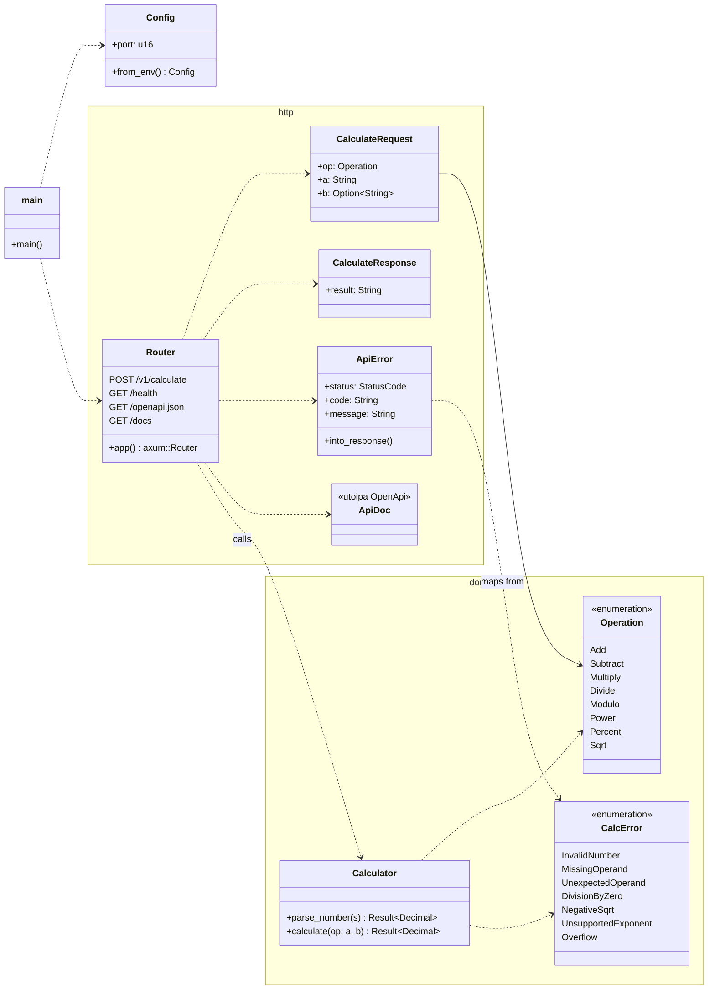
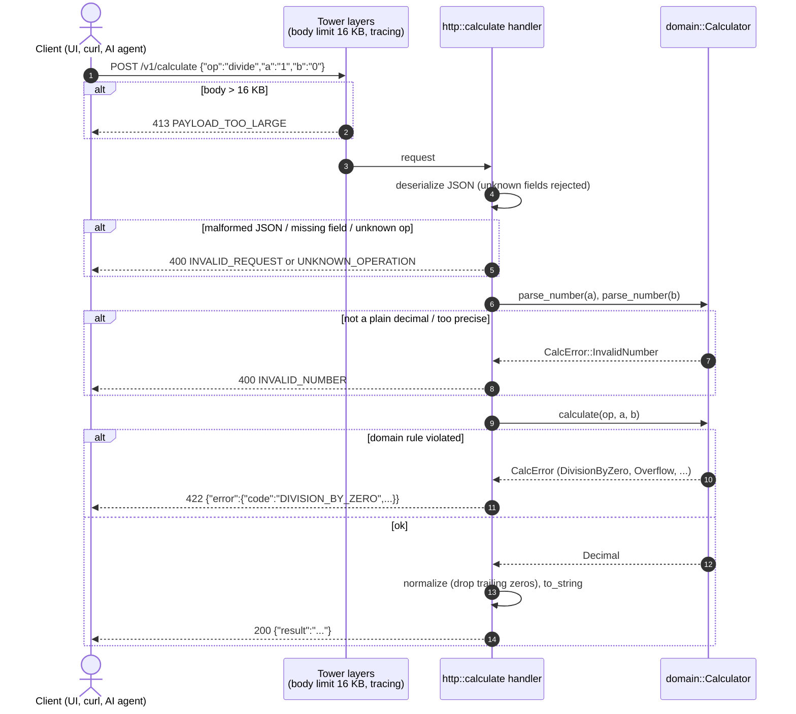

# Implementation plan: Calculator API

- Status: Draft, awaiting owner review
- Date: 2026-11-10
- Inputs: [PRD](../prd/PRD.md), [ADRs](../adr/README.md)

Each task is small enough for one commit (or a few), is built test-first (superpowers `test-driven-development`),
and names the requirements and ADRs it implements. A task is done when its tests pass and `cargo fmt --check`,
`cargo clippy -D warnings` and `cargo test` are green.

## Architecture overview

### Components (UML class diagram)

The `http` module depends on `domain`, never the reverse (ADR-0005). `domain` uses only `rust_decimal`.

### Request flow (UML sequence diagram)

## Tasks

| # | Task | Implements | ADR | Depends on |
|---|---|---|---|---|
| T1 | Cargo project skeleton: `lib.rs` with `app()`, `main.rs`, `Config::from_env` (`PORT`, default 8080), `GET /health` + integration test | FR-7, NFR-3 | 0001, 0005 | – |
| T2 | Domain: `parse_number` strict parser (plain decimals only, reject `1e3`, empty, too precise) + unit tests | FR-1, FR-4, FR-5 | 0002 | T1 |
| T3 | Domain: `add`, `subtract`, `multiply`, `divide`, `modulo` with checked ops, half-even rounding, normalization + unit tests (`0.1+0.2=0.3`, `1/3`, divide/mod by zero, overflow) | FR-2, FR-4, FR-5 | 0002 | T2 |
| T4 | Domain: `power` (integer exponents only), `percent` (a × b ÷ 100), `sqrt` (negative rejected) + unit tests | FR-2, FR-3, FR-5 | 0002 | T3 |
| T5 | HTTP: `POST /v1/calculate`, request/response DTOs, operand-count validation, `ApiError` mapping for every FR-5 row, 16 KB body limit + integration tests per error row | FR-1, FR-5, NFR-2, NFR-5 | 0001, 0003 | T4 |
| T6 | OpenAPI: `utoipa` annotations, `/openapi.json`, Swagger UI at `/docs` + test that the spec lists both paths | FR-6 | 0004 | T5 |
| T7 | Robustness: property test (random operand strings and ops never produce 5xx or panic) | NFR-5, AC-9 | 0002 | T5 |
| T8 | Dockerfile (multi-stage, distroless, non-root), `.dockerignore`, `railway.json` with `/health` check; verify `docker run -e PORT=9000` | NFR-3, NFR-4 | 0006 | T1 |
| T9 | GitHub Actions: fmt, clippy, test, docker build on PR and `main` | quality gate | 0007 | T1, T8 |
| T10 | README: how to run, API examples, and the owner's reflections | homework | – | all |
| T11 | Deploy to Railway (owner go-ahead required) and smoke-test `/health`, `/docs`, `0.1+0.2` | NFR-4, AC-7 | 0006 | T8 |

Order: T1 → T2 → T3 → T4 → T5 → T6, with T7, T8, T9 after T5/T1 as listed. T10 and T11 last.

## Test strategy

| Level | Where | What it proves |
|---|---|---|
| Unit | `src/domain/*` `#[cfg(test)]` | every operation, rounding and error rule, in isolation (fast, most tests live here) |
| Integration / API | `tests/api.rs`, router called in-process | each acceptance criterion: status code + JSON body, error shape, body limit, docs routes |
| Property-based | `tests/robustness.rs` with `proptest` | no input can crash the service or yield a 5xx (NFR-5) |
| Smoke | manual / CI `docker run` + `curl` | the container starts, honours `PORT`, serves `/health` |

Test names start with the requirement they cover, for example `fr5_divide_by_zero_returns_422`.

## Traceability

| Requirement | Tasks |
|---|---|
| FR-1 | T2, T5 |
| FR-2 | T3, T4 |
| FR-3 | T4 |
| FR-4 | T2, T3 |
| FR-5 | T2–T5 |
| FR-6 | T6 |
| FR-7 | T1 |
| NFR-1 Stateless | by design: no storage in any task |
| NFR-2 | T5 |
| NFR-3 | T1, T8 |
| NFR-4 | T8, T11 |
| NFR-5 | T5, T7 |
